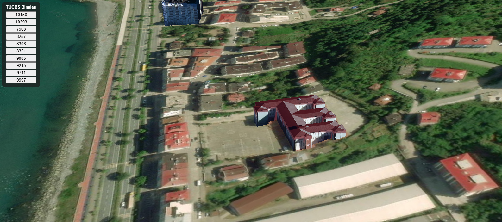

# tucbs-building

[](https://github.com/eapeker/tucbs-building/actions/workflows/ci.yml)

## Overview

Converts Turkey's national TUCBS 3D Building Model Sample Dataset (CityGML, LoD3)
to CityJSON and textured 3D Tiles, and shows the result in a CesiumJS viewer.
The 10 sample buildings are placed on Cesium World Terrain with their real textures.

- **Docker:** the whole pipeline (Java, Python and Node.js) is packaged in a single Docker image.
- **CI:** on every push, GitHub Actions builds the image and runs the pipeline end to end
  (CityGML -> CityJSON -> 3D Tiles), then checks the outputs.
- **Live demo:** https://eapeker.github.io/tucbs-building/viewer/index.html

### Screenshot



## Data

TUCBS 3B Bina Modeli Örnek Veri Kümesi (cbs.csb.gov.tr, CBS Genel Müdürlüğü,
public sample dataset): 10 buildings, CityGML LoD3, EPSG:5258 (TUREF / TM, Turkey).

The repository contains the raw data (`data/raw/`) and the generated outputs
(`data/cityjson/`, `data/3dtiles/`), so the viewer works without running the pipeline.

## Pipeline

```
data/raw/<id>/<id>.gml   (CityGML LoD3)
    -> scripts/convert_to_cityjson.sh       (citygml-tools)
data/cityjson/<id>.json  (CityJSON 2.0, textured)
    -> scripts/generate_3dtiles_textured.mjs
data/3dtiles/<id>/<id>.glb (per building, real textures) + data/3dtiles/tileset.json
    (one combined tileset, each building as a child tile with its own region)
```

- The CRS (EPSG:5258) is read from each CityJSON's `metadata.referenceSystem`.
- The tileset uses geographic `region` bounding volumes, so no manual ECEF/rotation
  transform matrix is needed.
- Each building's height is shifted to match Cesium World Terrain, sampled at its
  four corners (`scripts/sample_terrain_heights.mjs`).

Implementation notes and debugging history: [docs/DEVLOG.md](docs/DEVLOG.md).

## Run with Docker

```bash
docker build -t tucbs-building .
docker run --rm \
  -v "$(pwd)/data/cityjson:/app/data/cityjson" \
  -v "$(pwd)/data/3dtiles:/app/data/3dtiles" \
  tucbs-building
```

The image contains Java 17, Python 3 and Node 22. The `-v` flags mount the container's
output folders to `data/cityjson` and `data/3dtiles` on the host, so the generated files
stay in the repository after the container exits.

## Local setup

The local setup scripts are currently written for Windows (Git Bash).
On Linux and macOS, use Docker instead.

Requirements: Java 17+, Conda, Git Bash.

```bash
conda env create -f environment.yml      # Python side: cjio, pyproj, triangle
conda activate tucbs-building
bash scripts/setup_node.sh               # portable Node.js, no system install needed
cd tools && npm install && cd ..
bash scripts/setup_citygml_tools.sh      # CityGML -> CityJSON converter (Java, citygml4j)
```

Run the conversion:

```bash
bash scripts/convert_to_cityjson.sh      # data/raw/ -> data/cityjson/
node scripts/generate_3dtiles_textured.mjs   # data/cityjson/ -> data/3dtiles/
```

Run the second command from inside `tools/`, or with `tools/node` on the PATH.

### Viewer

```bash
cp viewer/config.example.js viewer/config.js   # paste your own Cesium ion access token
python -m http.server 8000                     # serve the repository root
```

Then open http://localhost:8000/viewer/index.html.

### PostGIS demo

The buildings' footprints and attributes (height, base elevation, footprint area) can be
loaded into a local PostGIS database to demonstrate spatial queries. CityJSON only stores
each building's bounding-box extent, so `scripts/generate_postgis_data.py` derives a
rectangular footprint from that bbox rather than the true outline.

```bash
docker run --name tucbs-postgis -e POSTGRES_PASSWORD=postgres -p 5432:5432 -d postgis/postgis
python scripts/generate_postgis_data.py      # data/cityjson/ -> data/postgis/buildings.sql
docker exec -i tucbs-postgis psql -U postgres < data/postgis/buildings.sql
docker exec -i tucbs-postgis psql -U postgres < scripts/postgis_example_queries.sql
```

The example queries cover nearest buildings, total footprint area, average height,
centroids and PostGIS-computed vs. precomputed area.

## Live demo

https://eapeker.github.io/tucbs-building/viewer/index.html

Deployed automatically on every push to `main` (`.github/workflows/pages.yml`).
The Cesium ion token is injected from a repository secret at deploy time and is never committed.

## License

The code is released under the MIT License (see [LICENSE](LICENSE)).

The sample building data is published by the Ministry of Environment, Urbanisation and
Climate Change (TUCBS) and is not covered by the MIT license.
